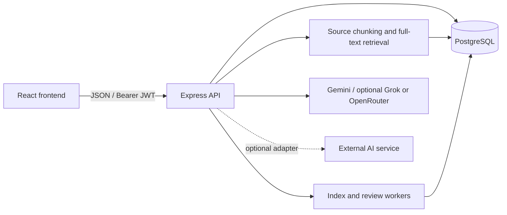
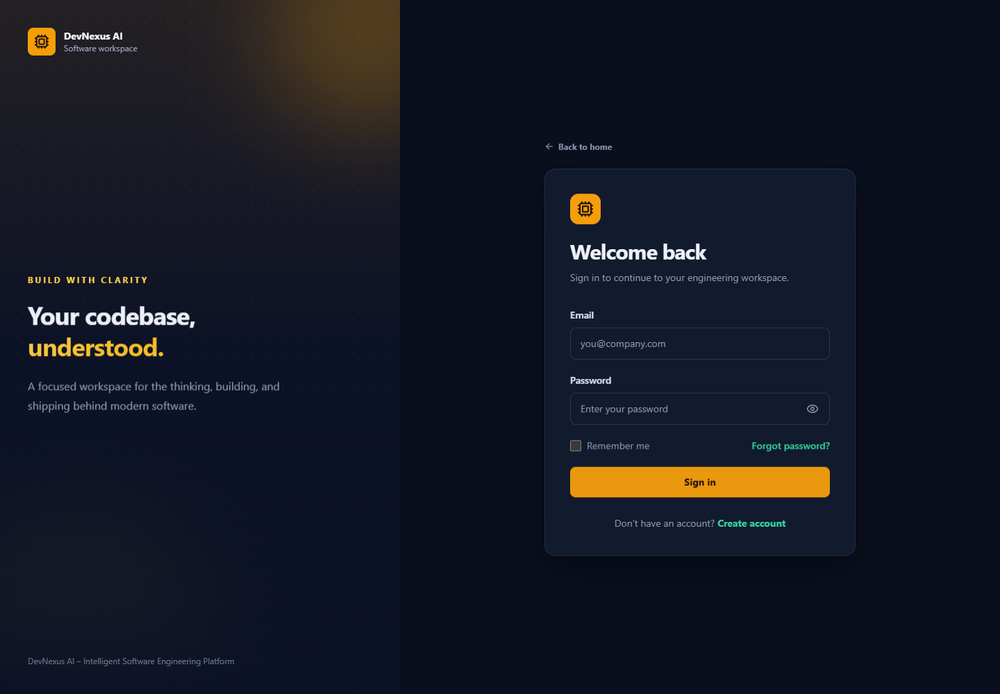

# DevNexus AI

**Intelligent Software Engineering Platform — final-year B.Tech capstone**

DevNexus AI brings source exploration, AI-assisted analysis and collaborative delivery into one workspace. Developers otherwise switch between code viewers, review tools, documentation and project trackers; this project explores how a shared source context can connect those activities.

The objectives are to make uploaded code easier to understand, surface review and security findings for human assessment, generate evidence-based documentation, and coordinate project work with explicit access controls.

## Implementation status

The following capabilities exist in the current source. Automated coverage is summarized below; this is not a claim that every live workflow has been validated.

| Area | Current implementation |
| --- | --- |
| Authentication | PostgreSQL user repository, bcrypt password hashes, email verification, JWT access tokens, refresh rotation/replay handling, password reset/change and login lockout |
| Roles and access | Developer, Team Lead and Project Manager roles; server-authoritative roles, token versions, ownership and project membership checks; permissions vary by endpoint |
| Source workspace | ZIP ingestion, source browsing, sync previews, chunk indexing and PostgreSQL full-text retrieval; 15 recognized source/configuration languages |
| AI assistance | Gemini integration, optional multi-provider Gemini/Grok chat routing, OpenRouter and an external AI-service adapter; grounded repository chat with bounded chunks and source citations |
| Code review | Single-source and repository review, scope discovery, queued batch processing, finding classification and triage; deterministic/demo paths remain distinct from provider analysis |
| Security analysis | Security-focused review profiles and findings with severity/location metadata; results require manual validation |
| Documentation | Source/evidence analysis, persisted generation requests, citations and Markdown/PDF export. Backend defines nine document types; only Project Overview is enabled in the current generation UI contract |
| Collaboration | Persistent projects, tasks, sprints, memberships, task assignment, comments and activity routes/components |
| Reporting | Project report aggregation and frontend exports; some legacy dashboards and modules contain demonstration fixtures |

## Technology and architecture

React 19, Vite 8, Tailwind CSS, React Router, TanStack Query and Zustand power the frontend. Node.js/Express, `pg`, JWT, bcryptjs, Nodemailer and yauzl power the backend. PostgreSQL stores users and the newer source/project/review/document/collaboration records. Node's test runner, Supertest and Playwright provide test infrastructure; pdfmake supports PDF export.



AI logic runs inside the Node backend. There is **no bundled Python/FastAPI service, LangChain pipeline, vector database or BullMQ worker** in this source tree. Repository assistance uses source chunks and PostgreSQL full-text retrieval rather than a verified embedding/vector search pipeline. Redis appears in legacy configuration but is not established as a runtime requirement. An automated GitHub repository import/OAuth integration has not been verified.

The frontend sends authenticated API requests; the backend validates access, reads project evidence, calls the configured provider and returns results. Provider credentials stay on the server. Uploaded code can be transmitted to an external provider when analysis is requested.

## Local setup

Use Node.js **22.12+** (verification used 24.16.0), npm, PostgreSQL and, for SQL setup, `psql`. Use a fresh empty database dedicated to this installation. Legacy Docker/Compose files were excluded from this source-only release; container deployment needs a separate review.

```powershell
git clone https://github.com/JagdishZate400/DevNexus-AI.git
cd DevNexus-AI
Copy-Item backend/.env.example backend/.env
Copy-Item frontend/.env.example frontend/.env
cd backend
npm ci
cd ../frontend
npm ci
cd ..
```

Set `backend/.env` locally. Generate a new random JWT secret, for example with `node -e "console.log(require('crypto').randomBytes(48).toString('hex'))"`. Never reuse a sample or test secret.

```dotenv
PORT=5001
NODE_ENV=development
JWT_SECRET=
DATABASE_URL=
CORS_ORIGIN=http://localhost:5173,http://localhost:4173
APP_URL=http://localhost:5173
SMTP_MODE=console
DEMO_VERIFICATION_CODE=
AI_PROVIDER=gemini
GEMINI_API_KEY=
GEMINI_MODEL=
AI_MULTI_PROVIDER_CHAT_ENABLED=false
```

Supply a PostgreSQL connection URL using your own dedicated user/password and database. Set a model ID available to your provider account. Without valid AI configuration, live generation is unavailable. Configure `SMTP_MODE=smtp`, host, port, TLS, sender and credentials for real verification/reset delivery. Console mode does not send or persist email content. For a local demonstration, explicitly opt into a development verification code with synthetic accounts, or configure SMTP. Production delivery fails when no transport is available. Disable development shortcuts and protect metadata logs.

Only the API base URL belongs in `frontend/.env`:

```dotenv
VITE_API_URL=http://localhost:5001/api
```

### Database initialization

Schema setup is explicit; there is no unified migration runner. For a **new empty database only**, explicitly apply `backend/scripts/create-users.sql`, then the forward `.sql` files under `backend/scripts/migrations/` in ascending numeric order (0132 through 0161). Do not apply `*.down.sql` during setup. Example after setting a session-local connection URL:

```powershell
psql "$env:DATABASE_URL" -v ON_ERROR_STOP=1 -f backend/scripts/create-users.sql
Get-ChildItem backend/scripts/migrations/*.sql |
  Where-Object { $_.Name -notlike '*.down.sql' } |
  Sort-Object Name |
  ForEach-Object {
    psql "$env:DATABASE_URL" -v ON_ERROR_STOP=1 -f $_.FullName
    if ($LASTEXITCODE -ne 0) { throw 'Migration failed; stop and inspect the fresh database.' }
  }
```

This sequence passed on a new isolated PostgreSQL 17 cluster: 21 scripts (the user schema plus 20 forward migrations), followed by backend startup and HTTP health/OpenAPI checks. Apply the migrations in the `public` schema; several explicitly reference it. The publication copy of migration 0161 contains schema changes only; local project-specific backfills were removed. Existing installations need a separately assessed upgrade plan.

Start `npm run dev` from `backend/` and, in a second terminal, from `frontend/`. Visit the Vite URL and register a demonstration account. No hardcoded administrator login is required or automatically seeded by app construction. A controlled administrative bootstrap procedure for elevated roles still needs documentation. `/health` indicates process status, not complete provider/database workflow readiness.

## Verification — 16 November 2026

All checks below used a separate copy with clean `npm ci` installs, Node 24.16.0 and synthetic data. The original development environment and databases were not used.

| Check | Actual result |
| --- | --- |
| Backend default offline tests | **541 recorded: 518 passed, 23 skipped, 0 failed** |
| Portable PostgreSQL integration tests | **31 passed, 0 failed, 0 skipped** on a verified new PostgreSQL 17 cluster |
| Frontend unit tests | **72 passed, 0 failed, 0 skipped** |
| Frontend production build | Passed; large bundle warnings remain |
| Frontend lint | Exit 0 with 8 warnings |
| Fresh dependencies | Backend and frontend `npm ci` passed in isolated directories |
| Fresh schema/startup | All 21 SQL setup scripts passed; backend startup, `/health` and OpenAPI HTTP checks passed |
| Full npm dependency audit | Backend and frontend: **0 known vulnerabilities** after seven targeted same-major updates, including development dependencies |
| Browser rendering | Login form rendered in a clean browser context without page errors; external requests blocked |
| Live providers / real SMTP / complete browser E2E | **Not tested**; AI adapters and mail delivery use mocks/test seams |

Backend `npm test` now defaults to an offline guarded runner. Use `npm run test:integration` only with a new explicitly marked disposable database; see [test safety and integration setup](docs/TESTING.md). Twenty-three offline skips include database/opt-in workflows; a separate portable integration run executes selected database cases. Historical integration suites remain gated. No bundled Python service or Python dependency manifest exists, so a Python dependency audit is not applicable.

The real database checks cover verified signup/login, token-version revocation, project permissions/persistence, source synchronization and retrieval, review/batch persistence, document storage, tasks/sprints, memberships, assignment eligibility/removal cleanup, comments, activity triggers and owner-scoped reports. Live LLM answer quality and external email delivery remain unverified. Lead/manager roles can read and edit project metadata globally; project deletion and several source/document/report/collaboration operations use stricter owner checks. Permissions are endpoint-specific.

## Screenshot



Captured from an isolated production preview with empty browser storage and external requests blocked. It contains no signed-in account, private project, credentials or uploaded code. It demonstrates the login UI, not a completed login workflow.

## Security and limitations

JWT verification pins HS256, issuer and audience and checks the user's current token version and role. API middleware includes Helmet, request limits, rate limits and a CORS allowlist. ZIP validation limits paths, extensions, expansion and input sizes. These controls reduce risk; they do not constitute a penetration-test certification.

Refresh/reset/verification state and some legacy modules remain memory-backed; restart and multi-instance behavior need further validation. Browser-persisted tokens are exposed if XSS occurs. The API trusts one proxy hop and requires a matching deployment topology. The publication copy rejects missing production mail delivery and no longer writes message bodies/codes/reset links to disk. Metadata logging still needs an operational retention policy. Review generated text and findings manually and obtain permission before submitting private code to providers. Demo findings and deliberately unsafe code strings are educational fixtures, not evidence that an uploaded project was analyzed.

Future work includes broader portable integration/browser coverage, tested upgrade/rollback procedures, durable multi-instance session storage, consistent authorization across modules, smaller frontend bundles, broader documentation UI enablement, live provider/SMTP validation and a reviewed container deployment. Semantic/vector retrieval and GitHub import may be added as separately validated capabilities.

This repository is a capstone implementation under active development, not a production security scanner. A distribution license has not yet been selected.
